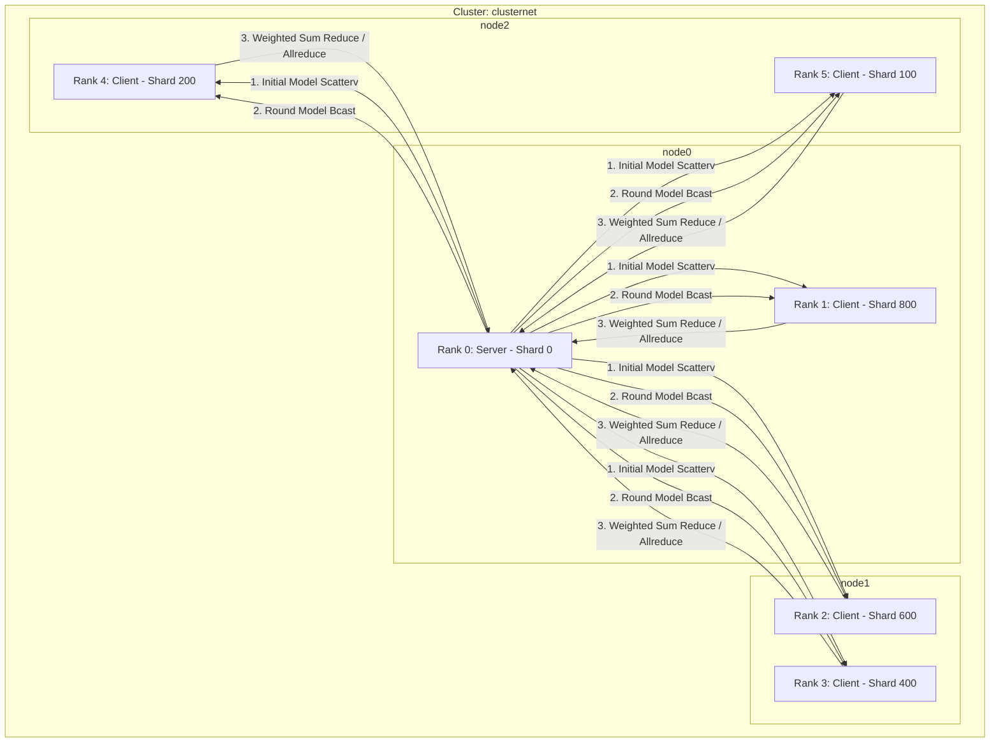

# Federated Learning Simulation with MPI Collectives: Optimization & Deadlock Analysis

> A reproducible 3-node containerized cluster running distributed Federated Averaging (FedAvg) with Open MPI collectives (`Bcast`, `Scatterv`, `Reduce`, `Allreduce`), eliminating communication loops and diagnosing a silent collective synchronization deadlock caused by client sampling.

**Author:** Moaaz Sherif · **Course:** SCx61 Distributed Computing · **Week 3 — MPI Collectives**

---

## 1. Overview & Architecture

This project simulates privacy-preserving Federated Learning (FedAvg) where a central server (Rank 0) coordinates 5 client devices (Ranks 1–5) holding non-IID local data shards. Instead of exchanging raw data, nodes exchange only weight updates.

---

## 2. Results & Verification

Comparing parallel executions against the canonical serial oracle (`compare_fl.py`, tolerance $10^{-12}$):

| Implementation | Collectives Used | Verification vs Serial Oracle | Status |
|---|---|---|---|
| **v1: Manual** | Hand-rolled `Send` / `Recv` loops | `max|dw| <= 5.551e-16` | Pass |
| **v2: Collectives** | `Scatterv` + `Bcast` + `Reduce` | `max|dw| <= 5.551e-16` | **Pass (Exact)** |
| **v3: Decentralized** | `Allreduce` + `Gather` | `max|dw| <= 5.551e-16` | **Pass (Bit-identical across ranks)** |

---

## 3. Incident: Collective Deadlock Under Client Sampling

When implementing client participation subsets (sampling), omitting an inactive rank from the round loop induced an immediate, silent **Deadlock** across the cluster.
- **Root Cause:** MPI Collectives are strictly collective operations across the entire communicator. Omitting a rank caused matching calls across rounds to shift out-of-phase.
- **Fix:** Inactive ranks participate in collective synchronization calls by passing zero-weight vectors (`[0*w, 0]`), preserving communication topology without skewing model convergence.

---

## Credits
Course materials and lab framework from **SCx61 Distributed Computing**, instructed by **Eng. Norhan Saber**, Scientific Computing Department, Faculty of Computers and Artificial Intelligence, Benha University.
